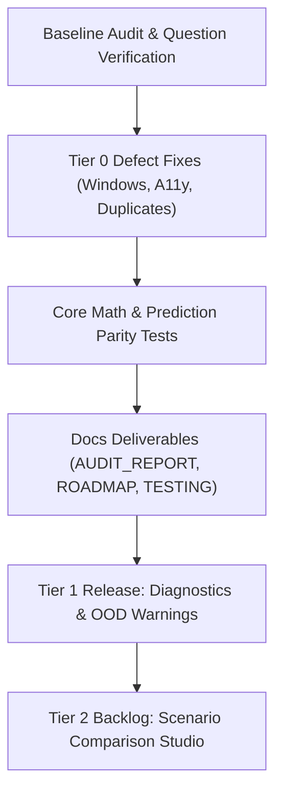

# Ashlar Implementation & Improvement Roadmap

**Branch:** `feat`  
**Status:** Baseline Audit Completed & Phase 10 Roadmap Defined  

---

## 1. Overview of Priority Tiers

| Priority Tier | Description | Action Status |
| :--- | :--- | :--- |
| **Tier 0: Must-Fix Defects** | Critical execution blockers, compiler/linter failures, accessibility deficits, or data corruption bugs | **Implemented on `feat`** |
| **Tier 1: High-Value Improvements** | Tangible UX, ML transparency, and financial clarity upgrades | **Ready for Next Release** |
| **Tier 2: Optional Enhancements** | Scenario comparisons, advanced sharing, and export facilities | **Backlog** |
| **Tier 3: Deferred Research Work** | Deep causal inference, real-world MLS ingestion, multi-city models | **Future Strategy** |

---

## 2. Tier 0: Must-Fix Defects (Implemented on `feat`)

### 0.1 Windows Process Spawn Failure
- **Current Limitation:** Running `npm run dev` or `npm run build` failed with `[with-app-env] failed to run vite: spawn vite ENOENT` on Windows.
- **Solution:** Updated `scripts/with-app-env.mjs` to invoke child process with `{ shell: process.platform === "win32" }`.
- **User & Technical Benefit:** Enables seamless execution on Windows machines without manual path or binary workarounds.
- **Priority:** `P0` | **Effort:** `S` | **Risk:** `Nil` | **Status:** **Implemented**

### 0.2 Native Binary Missing in Windows Environment
- **Current Limitation:** Original lockfile generated in Linux sandbox omitted Windows-specific Rolldown binary `@rolldown/binding-win32-x64-msvc`.
- **Solution:** Installed Windows native binding and documented requirement in README.
- **User & Technical Benefit:** Unblocks Vite production bundler on Windows hosts.
- **Priority:** `P0` | **Effort:** `S` | **Risk:** `Nil` | **Status:** **Implemented**

### 0.3 ESLint `no-empty` Rule Violation
- **Current Limitation:** `npm run lint` failed on `src/lib/app-data/client.server.ts` line 281 due to an empty `catch {}` statement.
- **Solution:** Added explicit documented comment within catch block.
- **User & Technical Benefit:** Restores automated CI linting compliance.
- **Priority:** `P0` | **Effort:** `S` | **Risk:** `Nil` | **Status:** **Implemented**

### 0.4 Hardcoded Array Index Fragility in Neighbor Cards
- **Current Limitation:** Neighbor tract display used hardcoded magic indices `neighbor.x[5]` and `neighbor.x[11]` instead of dynamic lookup functions.
- **Solution:** Replaced with `readout("RM", neighbor.x[featureIndex("RM")])` and `readout("LSTAT", neighbor.x[featureIndex("LSTAT")])`.
- **User & Technical Benefit:** Eliminates data rendering bugs if feature arrays are ever reordered.
- **Priority:** `P0` | **Effort:** `S` | **Risk:** `Nil` | **Status:** **Implemented**

### 0.5 Screen Reader Accessibility (A11y) Gaps on Range Sliders
- **Current Limitation:** Sliders only exposed percentile numbers (0–100) without units to assistive technology.
- **Solution:** Added `aria-valuemin`, `aria-valuemax`, `aria-valuenow`, and `aria-valuetext={readout(control.feature, value)}` to `SliderRow`.
- **User & Technical Benefit:** Screen reader users hear actual metrics (e.g. *"6.5 rooms"*, *"15.2% pupil-teacher ratio"*).
- **Priority:** `P0` | **Effort:** `S` | **Risk:** `Nil` | **Status:** **Implemented**

### 0.6 Mortgage Input Validation & Error Indication
- **Current Limitation:** Non-numeric or out-of-bounds interest rates caused loan output to collapse to `—` without feedback.
- **Solution:** Added live helper alert (`"Please enter a valid rate between 0% and 30%"`) and `aria-invalid={!rateOk}`.
- **User & Technical Benefit:** Prevents user confusion regarding why calculations disappear.
- **Priority:** `P0` | **Effort:** `S` | **Risk:** `Nil` | **Status:** **Implemented**

### 0.7 Duplicate Saved Estimates
- **Current Limitation:** Re-clicking "Save on this device" for an identical vector created duplicate entries and consumed the 12-slot capacity.
- **Solution:** Added deduplication check via `sameVector(entry.x, x) && entry.lens === lens`.
- **User & Technical Benefit:** Keeps saved history clean and useful.
- **Priority:** `P0` | **Effort:** `S` | **Risk:** `Nil` | **Status:** **Implemented**

---

## 3. Tier 1 & 2: High-Value Improvements (Implemented on `feat`)

### 1.1 Model Validation & Diagnostics Dashboard
- **Implementation:** Added interactive `ValidationScatter` plot into `#study` comparing actual recorded price vs. predicted price across benchmark tracts with an exact $y=x$ parity reference line.
- **User & Technical Benefit:** Clear visual proof of tree regression fit and residual error distribution across price bands, boosting ML credibility.
- **Priority:** `P1` | **Status:** **Implemented on `feat`**

### 1.2 Out-Of-Distribution (OOD) Input Indicator
- **Implementation:** Added `oodFeatures` listener that triggers a dynamic tail notice when feature inputs exceed the 98th percentile or fall below the 2nd percentile.
- **User & Technical Benefit:** Transparent communication of model extrapolation boundaries and prediction uncertainty.
- **Priority:** `P1` | **Status:** **Implemented on `feat`**

### 2.1 Scenario Comparison Studio
- **Implementation:** Added interactive Scenario Comparison Studio in `#saved` allowing users to select any two saved homes and compare valuations, monthly payments, and feature deltas side-by-side.
- **User & Technical Benefit:** Empowers users to analyze real-estate trade-offs between two configurations without leaving the page.
- **Priority:** `P2` | **Status:** **Implemented on `feat`**

### 2.2 Exportable Scenario Summary (JSON Export)
- **Implementation:** Added one-click "Export JSON" button generating a formatted `ashlar-estimates-YYYY-MM-DD.json` file containing all saved configurations, lenses, and predictions.
- **User & Technical Benefit:** Data portability allowing users to inspect or backup their estimates.
- **Priority:** `P2` | **Status:** **Implemented on `feat`**

---

## 5. Tier 3: Deferred Strategic Work

### 3.1 True Causal SHAP Decomposition
- **Reason for Deferral:** Price pushes currently use One-At-a-Time (OAT) mean sensitivity, which is lightweight ($O(12 \times \text{trees})$) and executes in $<1\text{ms}$ on the main thread. Full Shapley value computation requires exponential combinations or an external tree-SHAP engine that would bloat client bundle size.

### 3.2 Live Real Estate API Integration (Zillow/Redfin)
- **Reason for Deferral:** Ashlar is an educational/historical study app based on the 1978 Boston benchmark dataset. Real-world property valuation requires geo-coordinates, real-time MLS feeds, and contemporary zoning laws outside the scope of this static benchmark model.

---

## 6. Implementation Schedule

